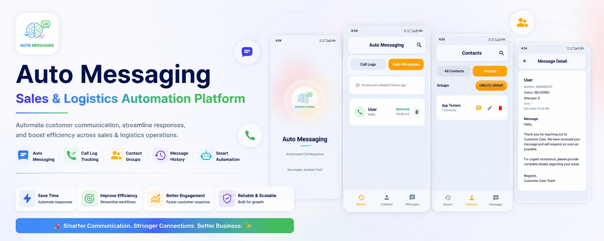
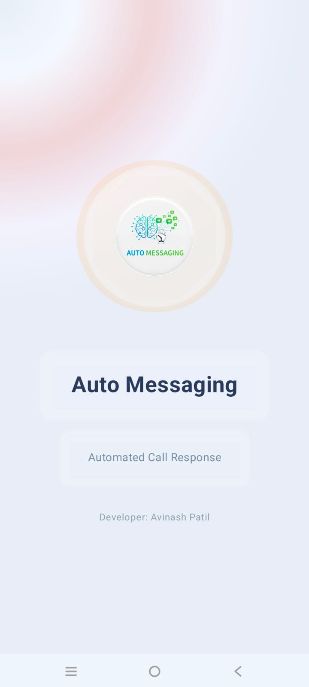
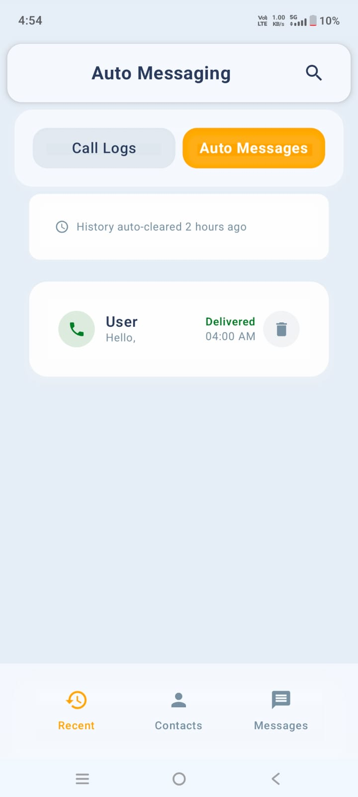
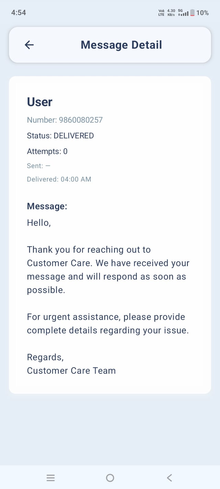
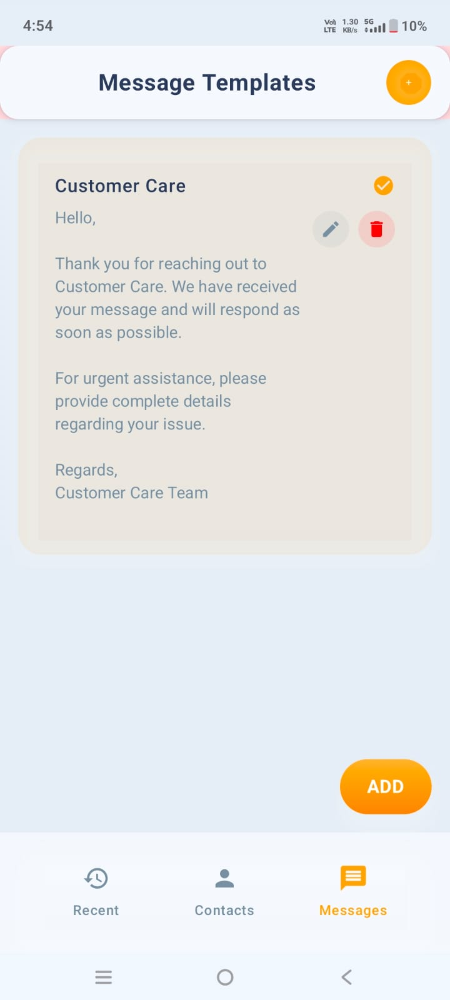
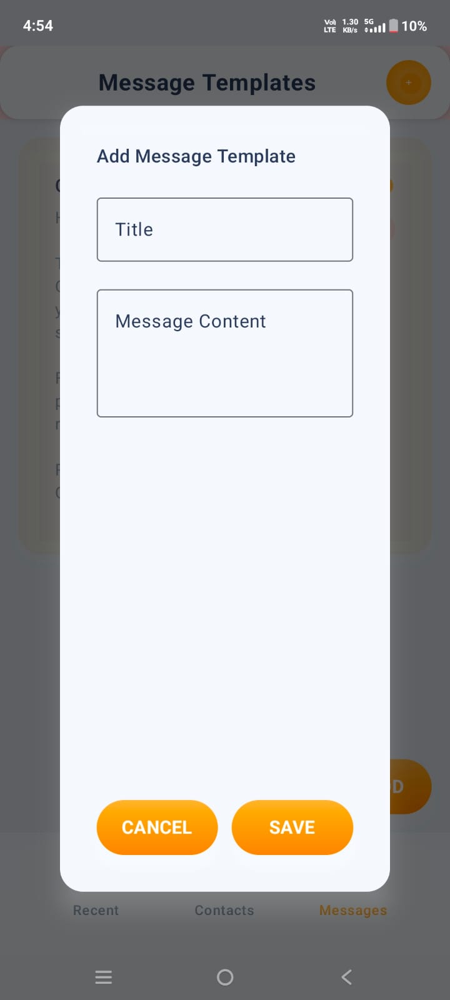

# AutoMessaging — Auto SMS Reply When a Call Ends

An Android app that **automatically sends an SMS message when a phone call ends**. If you miss a call or can't talk (driving, in a meeting), the caller gets an instant, polite text back — so no call ever goes unanswered in silence.



## What it actually does

1. An incoming call arrives → you miss it or hang up (phone state goes **IDLE**).
2. The app detects the call end, looks up the caller in your contacts/groups.
3. After your configured **reply delay** (e.g. 10 seconds), it sends the matching message template via **SMS**.
4. Every auto-reply is saved in a **history log** with delivery status.

It also handles outgoing-call ends and backfills truly missed calls via a call-log check, so replies are not lost if the system kills the app mid-call.

## Key features

- **Auto-reply on call end**: SMS goes out automatically when an incoming call ends or is missed.
- **Message templates**: create custom replies for situations like "In a meeting" or "Driving, will call back".
- **Groups**: organize contacts (family, clients, team) and assign a template per group, plus a default fallback message.
- **Priority contacts**: VIP callers can get their own dedicated reply.
- **Blacklist**: blocklisted numbers never receive auto-replies.
- **Reply history log**: full list of sent auto-replies with timestamps and SMS delivery status.
- **Bulk / group send**: send a message to a whole group at once from the app.
- **Master on/off switch + reply delay**: automation can be paused anytime; delay before sending is configurable.
- **Reliability engineering**: foreground call-detection service, auto-start on reboot, keep-alive checks, missed-call backfill worker, daily history reset.
- **Fully offline**: everything (contacts, templates, logs) lives in the on-device Room database — no account, no server.
- **Modern UI**: Jetpack Compose with glassmorphism cards and full dark-mode support.

## How it works (code map)

```
Incoming call ends (RINGING → IDLE)
        ↓
PhoneStateReceiver (manifest-registered broadcast)
        ↓
CallDetectionService (foreground service)
        ↓
Resolve contact → group → template (blacklist/priority checked)
        ↓
Wait reply delay → SmsManager.sendTextMessage()
        ↓
SmsStatusReceiver → Room log (AutoReplyLogEntity)
```

Reliability extras: `BootReceiver` (restart after reboot), `KeepAliveReceiver`, `CallLogPollerWorker` (backfills calls the receiver missed), `DailyResetWorker` (clears history), `DiscrepancyLogEntity` (diagnostics).

Start reading here:
- `service/PhoneStateReceiver.kt` — call-end detection entry point
- `service/CallDetectionService.kt` — decides who gets which reply and sends the SMS
- `service/CallLogPollerWorker.kt` — missed-call safety net
- `data/database/AutoMessageDatabase.kt` + `data/dao/` — 8 Room tables (templates, groups, contacts, logs, blacklist, priorities)
- `di/AppModule.kt` — Hilt wiring

## Tech stack

- **Language/UI:** Kotlin, Jetpack Compose, Material 3, Navigation Compose
- **DI:** Dagger Hilt
- **Async:** Kotlin Coroutines + Flow/StateFlow, WorkManager
- **Local data:** Room (SQLite) with 8 entities
- **Telephony:** `SmsManager`, `PhoneStateReceiver`, foreground service (`specialUse` / `phoneCall`), call-log access
- **Image loading:** Coil
- **Testing:** 24 JVM unit tests (JUnit4) over phone-number normalisation, anti-spam rules, message
  personalisation and the Room repositories — see [Tests](#tests)

## Screenshots

### Splash Screen


### Auto Messaging Screen


### Message Detail Screen


### Group & Bulk Message Send Screen


### All Message Templates Screen


### Add Message Screen


## Demo Video

[Watch Demo Video](https://drive.google.com/file/d/10JKgQ0Il-legKnyOIr0kxSIhcdXldkxz/view?usp=sharing)

## Setup

1. **Prerequisites**: Android Studio (Arctic Fox or later) and JDK 17 (the app targets Java 17).
2. **Clone**:
   ```bash
   git clone https://github.com/Avi6855/AutoMessaging.git
   ```
3. Open the cloned folder in Android Studio and let Gradle sync.
4. Run on a **physical device with a SIM** (emulators can't place real calls or send real SMS):
   ```bash
   ./gradlew installDebug
   ```
   or click **Run 'app'** (`Shift+F10`).
5. Grant the permissions below when asked, enable the master auto-reply switch, set your delay + default message — then test with a missed call.

## Tests

24 JVM unit tests cover the automation logic, so no device or emulator is needed:

| Suite | What it pins down |
|---|---|
| `PhoneNumberUtilsTest` (7) | Number normalisation and matching (`9860080257` / `+919860080257` / `09860080257` resolve to one key) |
| `SmsAntiSpamHelperTest` (9) | Per-hour and per-day send limits, `{name}` personalisation and the exact-message guarantee |
| `MessageRepositoryImplTest` (4) | Template and message CRUD through the Room DAO |
| `GroupRepositoryImplTest` (4) | Group / member grouping used to pick the reply template |

```bash
./gradlew :app:testDebugUnitTest
```

## Permissions used (and why)

- `READ_CONTACTS` — match callers to contacts/groups.
- `READ_CALL_LOG` + `READ_PHONE_STATE` — detect when a call ends and backfill missed calls.
- `SEND_SMS` + `RECEIVE_SMS` + `READ_SMS` — send replies and track delivery status.
- `FOREGROUND_SERVICE` (+ `PHONE_CALL` / `DATA_SYNC` / `SPECIAL_USE` types) — keep call detection alive.
- `RECEIVE_BOOT_COMPLETED` — restart detection after reboot.
- `POST_NOTIFICATIONS` — foreground-service status (Android 13+).
- `WAKE_LOCK`, exact alarms — reliable delayed sending.

**In-app settings**: master on/off toggle, reply delay (seconds), default fallback message.

## Privacy

- All contacts, templates and logs stay on the device (Room database). No account, no server, no analytics.

## Roadmap

- More delivery insights in the history log.
- Per-contact quiet hours (no reply late at night).
- Dual-SIM selection for the sending SIM.

## Author

**Avinash Patil** — Android Engineer | Kotlin | Jetpack Compose

🔗 [LinkedIn](https://www.linkedin.com/in/avinash-patil-278011228/) · 💻 [GitHub](https://github.com/Avi6855) · 📧 avinashpatil6855@gmail.com

## License

MIT License
